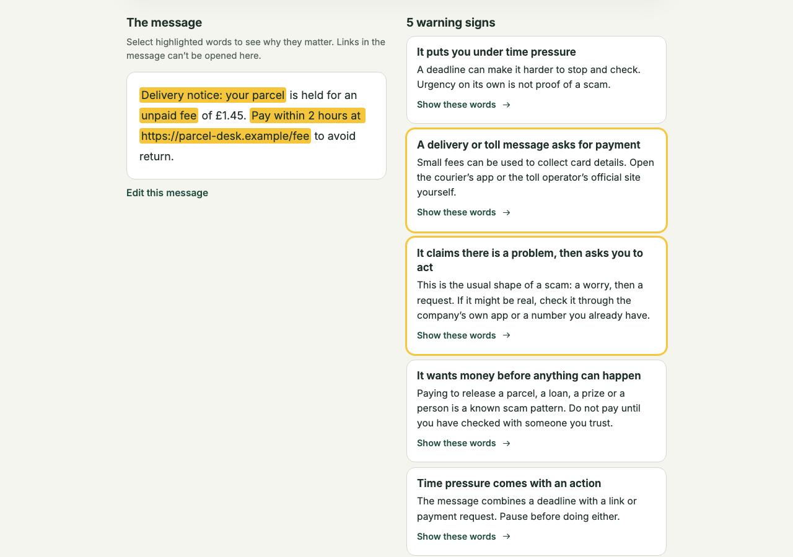

# Second Look

**A private second opinion on a suspicious message. No account. No upload. Text checks work offline.**

Live demo: https://yy5652-hash.github.io/second-look/

Second Look is a static web app (PWA) for SafeSpace Hacks. Everything runs in the browser on the
user's own device. It never opens, fetches or resolves a link in a message.



## The problem

Scam messages work by making a person act before they think: pay a small fee, share a code, call
a number, install an app. The people who hesitate most, often an older relative or a busy student,
have few places to get a quick, calm second opinion. After someone has already clicked or paid,
there is even less plain guidance.

## Who it is for

Someone who got a text, email or DM and is not sure whether to click. They may not be technical.
They should not need to create an account or hand a private message to a company.

## What it does

- **One tap to a result.** "Paste and check" reads the clipboard when you press it and shows the
  result straight away. You can also type, or drop, choose or paste a screenshot. Once installed on
  Android, you can share a message to the app from your messages app. The service worker answers
  that share on the device, and the share target is declared only after the worker is active.
  Screenshots are read on the device with
  Tesseract (self-hosted, loaded only when an image is first used). The recognised text appears in
  an editable box before anything is checked. QR codes in images are decoded with jsQR and the
  link is added without being opened.
- **Three outcomes, never "safe":** strong signs of a scam, some warning signs, no known signs
  (which says in words that it does not mean the message is safe). If most of the message is in a
  writing system the wording checks do not read, the result says "We could not judge the wording"
  instead of guessing. Link checks still run.
- **The result takes over the screen,** with the outcome and the next step first. On a phone, the
  two things you may need next stay under your thumb.
- **Every finding points at the exact words.** Nearby clues merge into readable phrases. Highlights
  and findings are linked both ways and reachable by keyboard, with a plain-language reason for each.
- **Three quick questions when the wording settles nothing.** Does it ask for a code, a password or
  card details? For money? To open a link, call a number or install something? Any "yes" or "not
  sure" gives specific advice for that request, from fixed rules, with nothing uploaded.
- **A link inspector** shows the real registrable domain, and flags lookalikes of known brands,
  mixed alphabets, encoded (punycode) hosts, raw IP addresses, `name@host` tricks, link shorteners,
  plain HTTP and a short list of risky endings. Message links are never rendered as clickable
  anchors.
- **A safe next step** that fits the pattern (for example, open the courier's app yourself).
- **"Already clicked or paid?"** Pick everything that happened to get one checklist, most urgent
  first, with progress you can tick off. It builds a summary to copy or print for your bank or the
  police. You also get an honest note that money may not come back, a warning about "recovery" scammers who charge a fee, and
  reporting routes (US, UK, Canada, China, elsewhere), each with its source and the date it was
  last checked. It does not replace emergency services.
- **"Ask someone you trust":** builds a note to copy with emails, phone numbers and long digit runs
  removed and links made unclickable. It tells the reader to check it first, because names are not
  removed. You send it with your device's share sheet or by copying it. The app itself sends nothing.
- **Larger text** with one button, plus dark and light themes.
- **Privacy you can check.** The message is never uploaded. A strict Content Security Policy
  blocks requests to other sites. A live panel counts the requests to other sites that the page can
  see (the browser's PerformanceObserver; extensions and worker traffic may not appear). You can verify it yourself with the browser's Network tab or airplane mode.
  The message is held in memory only: never in storage, the address bar or history. Only the theme
  and text size choices may be stored.

## How it differs from uploading checkers

Several scam checkers (for example Bitdefender Scamio, Trend Micro ScamCheck, NordVPN Scam Checker
and IsThisAScam) send the message or screenshot to a server for analysis, which allows
database comparison and AI models that an on-device tool cannot match. Some ask for an account or
limit free use. Second Look makes a different trade: the check happens on the device, nothing
leaves it, and you can verify that. The cost is that it relies on transparent rules and a small
local brand list rather than a live database. It also explains each finding with the exact words in
the message, and it includes a recovery path for people who have already acted.

## Run it

Requires Node.js 22 or newer.

```bash
npm ci
npm run dev          # development server
npm run build        # type-check and build to dist/ (also copies the OCR files into public/ocr)
npm run preview      # serve dist/ locally
```

Deploying `dist/` to any static host works. The app uses relative paths, so a GitHub Pages
subpath is fine.

## Test it

```bash
npm test             # vitest: engine rules, spans, negation, genuine messages, redaction, adversarial input
npm run build
npm run test:e2e     # Playwright against the built app, in Chromium, Firefox and WebKit
npm run eval:dev     # development half of the corpora, for tuning
npm run eval         # held-out half; writes docs/EVALUATION.md and docs/evaluation.json
npm run screenshots  # writes docs/screenshots
```

The end-to-end tests cover the paste flow with highlights, one-tap paste, the three questions, image
OCR (including a browser without SIMD), a QR code in an image, the recovery checklist and summary, a
shared message answered by the service worker, reloading offline, zero requests to other sites, no sideways scrolling at 320 px, HTML in a message shown as text, and
message links never rendered as anchors.

## Evaluation

All corpus numbers come from `docs/evaluation.json`; `docs/EVALUATION.md` has the full tables.

**Blind test (the most honest number here).** A separate AI agent with no access to the rules wrote
60 scam and 60 genuine messages in modern wording, many of them deliberately hard. We scored them
once, and the rules have not changed since. They are synthetic, not real user messages.

|                                                      | Count   |
| ---------------------------------------------------- | ------- |
| Scams flagged "strong signs" or "some warning signs" | 30 / 60 |
| Scams flagged "strong signs"                         | 12 / 60 |
| Genuine messages flagged                             | 3 / 60  |

So about half of those scams got "no known signs". That is why the result never says "safe", and
why every outcome tells people to check for themselves.

**Public corpora.** Messages were split into development and held-out halves by a hash of the text.
Rules were tuned only on the development half and on our own fixtures. The held-out half was scored
twice: an earlier, narrower rule set flagged 52 of 160 smishing messages, which led us to broaden
the rules using development data. Treat the second-run numbers below as possibly optimistic.
Intervals are Wilson 95%.

UCI SMS Spam Collection, held-out half (2012; its "spam" includes ordinary marketing):

|                                            | Count     | Rate (95% interval)      |
| ------------------------------------------ | --------- | ------------------------ |
| Genuine messages flagged "strong signs"    | 1 / 2,434 | 0.04% (0.01 to 0.23%)    |
| Genuine messages flagged strong or caution | 4 / 2,434 | 0.16% (0.06 to 0.42%)    |
| Spam flagged "strong signs"                | 45 / 360  | 12.50% (9.47 to 16.32%)  |
| Spam flagged strong or caution             | 160 / 360 | 44.44% (39.40 to 49.61%) |

SMS Phishing Dataset (Mishra and Soni, 2022, CC BY 4.0), held-out half, with rows already in the UCI
collection removed:

|                                            | Count    | Rate (95% interval)      |
| ------------------------------------------ | -------- | ------------------------ |
| Genuine messages flagged strong or caution | 1 / 273  | 0.37% (0.06 to 2.05%)    |
| Smishing flagged "strong signs"            | 48 / 160 | 30.00% (23.44 to 37.50%) |
| Smishing flagged strong or caution         | 81 / 160 | 50.62% (42.95 to 58.27%) |

**A model we rejected.** We trained a small on-device word model on the development half.
Cross-validated there, it flagged 82% of spam and smishing with 0.5% false alarms. On 30 modern
genuine messages it raised 9 false alarms, including a plain card receipt, and it caught only 6 of
15 modern scams. The 2012 corpus has almost no business messages among its genuine texts, so the
model had learned that a commercial tone means spam. We removed it. Corpus scores alone would have
hidden this.

Our own fixtures in `tests/fixtures` were used for tuning, so they only show that the rules do what
we meant.

## A safer outcome

A text says a parcel is held for an unpaid fee of £1.45, to be paid within 2 hours at a link.
Second Look highlights the fee, the deadline and the link, and shows that the link's main address is
`parcel-desk.example`. Its next step is to open the courier's app or the toll operator's official
site yourself and check for a real fee there. The person can check the delivery without giving
the message their card details.

## A limitation

The wording checks work on English only. For a message mostly in another writing system, Second
Look says it could not judge the wording and only the link checks apply. Its list of known brands
is small and curated, so a lookalike of a company that is not on the list will not be flagged as
one. It cannot confirm who sent a message.

## Credits

- **Libraries:** Preact, tldts (with the Public Suffix List), Tesseract.js with its English model,
  jsQR, Workbox, vite-plugin-pwa, Vite, Vitest, Playwright. Test helpers: qrcode, sharp. See
  `THIRD_PARTY_NOTICES.md` for versions and licences.
- **Datasets (local evaluation only, not shipped):** UCI SMS Spam Collection, Almeida and Hidalgo
  (2012), CC BY 4.0, DOI 10.24432/C5CC84. SMS Phishing Dataset for Machine Learning and Pattern
  Recognition, Mishra and Soni (2022), Mendeley Data, CC BY 4.0, DOI 10.17632/f45bkkt8pr.1.
- **Reporting information:** each entry in the app links to its official source with the date it
  was last checked (1 November 2026).
- **AI assistance:** Claude Code and Codex wrote the code under Yi Yu's direction. No AI model judges
  messages. The only model shipped is Tesseract's English OCR model, which reads screenshots on
  the device.
- **Design:** system fonts and original inline SVG icons.

## What was built during the event, and what already existed

Everything in this repository, meaning the rule engine, link inspector, evidence interface,
privacy panel, recovery guide, image pipeline, offline setup, tests, evaluation and documentation,
was built during the SafeSpace Hacks event window, starting on 1 November 2026. Only the open-source
components listed under Credits and in `THIRD_PARTY_NOTICES.md` existed beforehand. They are used
as published.

## Responsible use

Second Look is a limited aid, not a guarantee, and it does not replace emergency services. If you
are in immediate danger, call your local emergency number. The example messages are made up and
use reserved example domains.

## Licence

MIT. Copyright (c) 2026 Yi Yu. See `LICENSE`.
